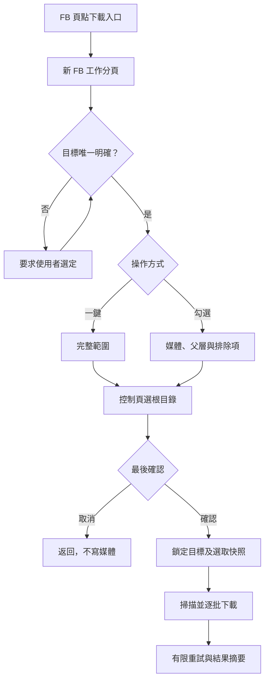
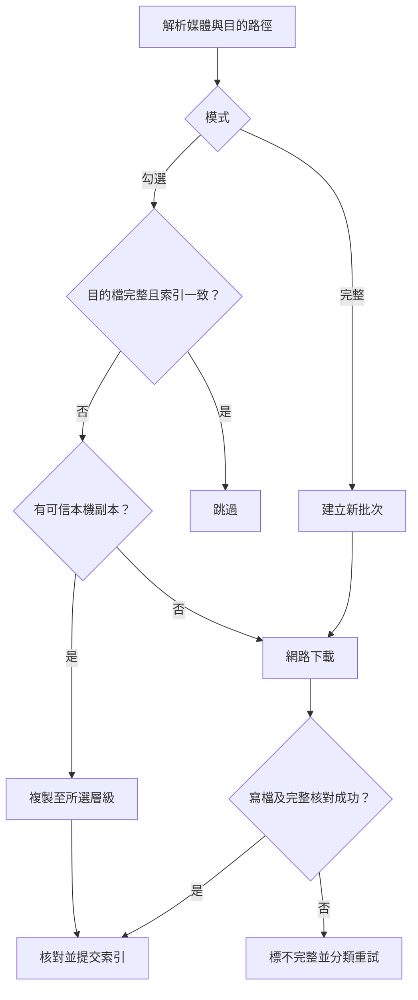
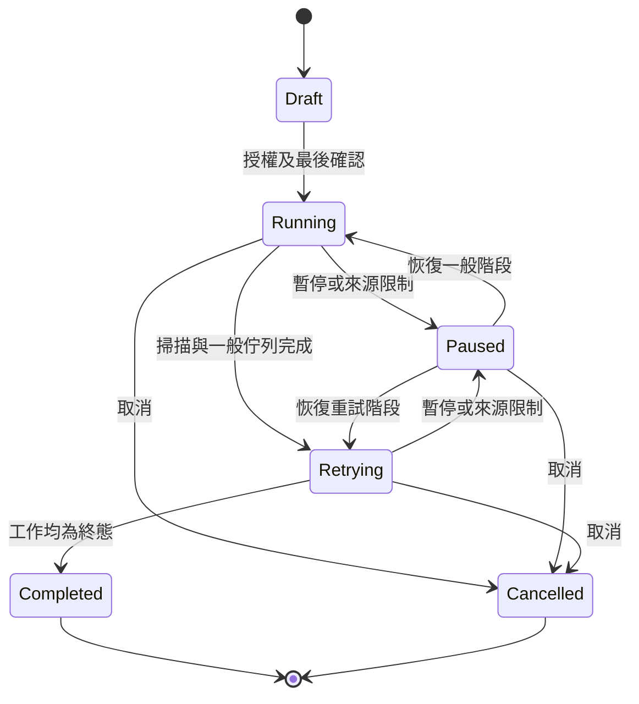

# SA：系統分析與業務流程
版本：1.0｜2026-10-24｜開發前設計，尚未實作驗收

預定專案：`D:\尚\side project\codex\FB_Download`

依據 Facebook_Downloader_Spec_v1.md v1.1 及使用者最新需求。此四份文件配套使用，原規格保留作需求來源。技術能力與版本待 P0 實測，未通過不得宣稱支援。

## 1 角色與邊界
使用者操作 FB、授權目錄與最後確認；Facebook 提供可見來源，Chrome 提供分頁與檔案能力。工具不代登入，不自建後端或 DB，不繞過來源驗證。

## 2 業務主流程

## 3 檔案處理流程

## 4 選取規則
同目標共用模型，不同目標隔離。父層全選包含未載入子項；取消子項形成該父層關聯的排除，父層顯示部分選取。媒體透過其他相簿或獨立明確選取時，不受不相關父層排除誤刪。取消父層時清除其排除，保留獨立選取。

最後確認凍結選取快照，後續 UI 或目標切換不影響執行中工作。同媒體來源取得去重與各目的檔完成分開處理。

## 5 工作狀態

暫停記錄原階段，恢復回原階段。Completed 可含失敗，不能冒充全成功。控制頁關閉為中斷；重開須重新授權及核對快照，不承諾瀏覽器關閉後仍執行。

## 6 例外
| 情境 | 行為 |
|---|---|
| 目標不明或混合頁 | 阻止開始，要求選定 |
| 未登入或無權限 | 提示／略過，不繞過 |
| 分類掃描失敗或未支援 | 列來源缺口，不標全帳號成功 |
| URL 過期 | 有限重新解析 |
| 單檔無位元組進度 | 中止該檔、釋放名額、延後 |
| 429／驗證要求 | 暫停受影響來源 |
| 磁碟滿／授權撤銷 | 暫停寫入，保留恢復資訊 |
| 索引失配／部分檔 | 重新核對，不算成功 |
| 取消或關控制頁 | 已完成保留，未完成獨立標記 |

## 7 進度定義與未決
掃描中顯示已發現 N、已處理 X、階段及耗時，不當作最終比例。掃描封閉後處理率 = 終態目的工作／已知目的工作；成功、跳過、失敗分列，重試另報進度，來源缺口持續顯示。ETA 以有效樣本及剩餘已知量估算，不足則顯示估算中。

P0 必須驗證身份、分類、目錄授權、跨來源串流、影片音軌及進度訊號。可見不代表工具已能取得，每類來源須獨立驗證。

