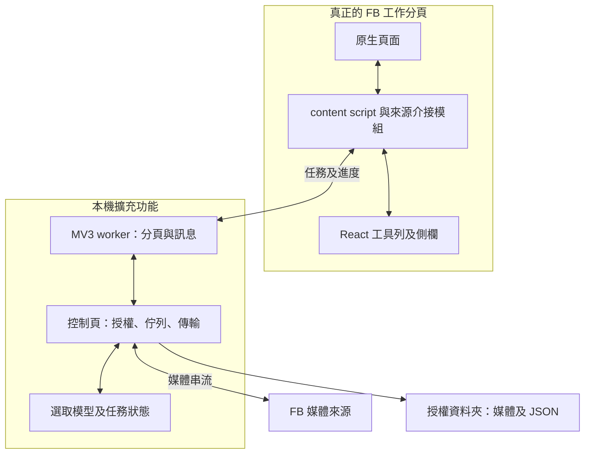

# SD：系統設計與技術架構
版本：1.0｜2026-10-24｜開發前設計，尚未實作驗收

預定專案：`D:\尚\side project\codex\FB_Download`

依據 Facebook_Downloader_Spec_v1.md v1.1 及使用者最新需求。此四份文件配套使用，原規格保留作需求來源。技術能力與版本待 P0 實測，未通過不得宣稱支援。

## 1 技術選型
| 層 | 建議技術 | 職責 |
|---|---|---|
| FB 頁面介接 | TypeScript、DOM API、MutationObserver | 目標／卡片／分類及 SPA 變化 |
| 自有 UI | React、TypeScript、CSS、Shadow DOM | 工具列、側欄、選取與進度 |
| 分頁協調 | Chrome MV3 service worker | 分頁與 session 綁定、訊息校驗 |
| 長任務控制頁 | 擴充功能可見 HTML 頁面 | 目錄授權、排程、傳輸、寫檔 |
| 本機保存 | File System Access API、JSON | 目錄、索引及快照，須 P0 驗證 |
| 串流 | fetch、ReadableStream、AbortController | 有限併發、取消及無進度偵測 |
| 開發 | Vite、pnpm、Vitest、Playwright | 打包、型別檢查、單元與整合驗證 |

實作時選官方相容版本並鎖 lockfile。Node.js 只供開發；無正式後端。chrome.storage.local 僅少量偏好與恢復提示，詳細資料存授權目錄 JSON；不用 IndexedDB、SQLite 或雲端 DB。

## 2 技術架構圖

worker 可終止，不作長任務主機。控制頁持有目錄 handle，保持開啟；不經 JSON 訊息傳 handle 至 FB。不複製整頁 DOM 或 iframe 嵌入 FB。

## 3 模組與目錄
| 目錄 | 責任 |
|---|---|
| src/content | 入口、路由、卡片掛載 |
| src/adapters/facebook | 身份、分類、相簿、媒體解析 |
| src/ui | 工具列、側欄、三態選取 |
| src/background | 分頁綁定與訊息驗證 |
| src/controller | 目錄授權、最後確認、生命週期 |
| src/core | 選取展開、佇列、去重、重試與進度 |
| src/files | 安全命名、串流、索引與恢復 |
| src/shared | 型別、協定、錯誤碼 |
| tests、docs | 測試資料／案例、本套文件與證據 |

## 4 資料契約
JSON 皆有 schemaVersion；未知大小與總數用 null。
| 實體 | 主要欄位 |
|---|---|
| Target | targetId、name、type、sourcePageUrl |
| Session | sessionId、sourceTabId、workTabId、targetId |
| Selection | revision、targetId、explicitMedia、containers、excludedMemberships |
| Media | mediaId、identityStrength、quality、type、sourcePageUrl、memberships |
| Membership | categoryId、albumId、parentId、sourceName |
| Job | jobId、mode、target、selectionSnapshot、batchId、state、scanState |
| DestinationTask | taskId、mediaKey、relativePath、state、bytesWritten、expectedBytes、attempts、errorCode |
| FileRecord | mediaKey、quality、relativePath、size、checksum可選、status、completedAt |
| Snapshot | job、待辦與終態、可恢復掃描游標、savedAt |

mediaKey 優先穩定 ID＋品質。弱識別不可只靠短效 CDN URL 當永久鍵。短效媒體 URL 僅記憶體，恢復重新解析；索引不保存憑證或含驗證參數 URL。

## 5 訊息與介面
共同 envelope：version、type、requestId、sessionId、targetId、jobId可選、payload。
| type | 功能 |
|---|---|
| OPEN_WORKSPACE | 來源 URL → 綁定新分頁 |
| TARGET_RESOLVED | 目標及可靠度／歧義 |
| SELECTION_CHANGED | 規則及 revision |
| PREPARE_JOB | 模式、目標、快照 → 草稿 |
| CONFIRM_JOB | 控制頁最後確認 → 啟動 |
| SCAN_BATCH | 媒體關聯及掃描狀態 |
| JOB_PROGRESS | 階段、計數、速率、ETA與原因 |
| PAUSE_JOB／RESUME_JOB／CANCEL_JOB | 狀態控制 |
| JOB_RESULT | 成功、跳過、失敗、來源缺口 |

驗證 sender、tab、session、target、結構與 payload 大小；身份來自 worker 綁定，不能信網頁自報。requestId 冪等，同任務重複確認不多開。只允許驗證的媒體來源，不提供任意 URL 代理。

## 6 佇列與檔案提交
掃描按批輸出、有界佇列及背壓，上限 P0 壓測決定。下載初始 3、範圍 1–4；單目標掃描 1。30 秒無新增位元組中止延後，退避不佔名額；初次外最多 2 次。429／驗證要求暫停來源。大影片持續傳輸不受固定總時長截斷。

寫入：驗證相對路徑 → 獨立部分檔串流 → 關閉與完整核對 → 提交目的檔 → 索引 complete。提交與快照替換方式 P0 驗證，不假設原子重新命名。中斷後部分檔或索引失配要重新核對。若無 Range 及可信驗證條件，重跑未完成檔，不承諾位元組續傳。

跨分類取得一次後串流本機複製，避免整部影片常駐 JS 記憶體。拒絕絕對路徑、磁碟代號、.. 及跳脫根目錄；處理 Windows 保留名稱、非法字元、長度及碰撞，保留原名對照。未知同名不覆寫，不刪舊檔。

## 7 安全、生命週期與待驗證
不讀 Cookie、不收帳密、不載遠端程式碼、不外傳目錄 handle。host permissions 最小化，精確來源待 P0 決定。跨來源與登入媒體取得逐類實測；影片音軌或合併不支援須揭露。

控制頁失權／磁碟滿暫停；關閉不繼續。重開選根目錄並核對快照及實體檔。寫入關閉成功才標完整；大小相同不等於內容完全相同，可按需雜湊。

沿用原規格官方參考，實作時重新查核：
- https://developer.chrome.com/docs/extensions/develop/concepts/content-scripts
- https://developer.chrome.com/docs/extensions/develop/concepts/network-requests
- https://developer.chrome.com/docs/extensions/develop/concepts/service-workers/lifecycle
- https://developer.chrome.com/docs/capabilities/web-apis/file-system-access

本文未重新查核平台能力。P0 核心假設不成立先提出替代，不擅自加入 DB、後端、EXE 或 Native Messaging。

